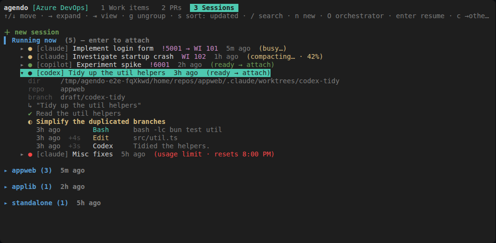

# agendo

`agendo` — a little console for launching and wrangling your Claude, Copilot and Codex agent sessions. (_agenda_ + _do_; also the Latin root of _agent_.)



`agendo` manages your Claude, Copilot and Codex agent sessions as tabs in one tmux session,
organized around your Azure DevOps work items or GitHub issues. It automatically
finds every session you've ever started and matches each to the PRs and issues it
belongs to — by branch name, PR/issue number, and the like — so you see what's
assigned or open, with each item's PR and CI status, then jump into (or attach to)
the agent already working on it, or spin up a fresh one in its own worktree, all from
one keyboard-driven list. Wrangling those tmux sessions is the whole point, so it
runs as a single tmux session by default.

## Run

Requires:

- **[bun](https://bun.sh)** — agendo runs on bun.
- **tmux** — agendo manages your agents as tabs in one tmux session.
- a backend CLI, auto-detected on your `PATH`:
  - **`az`** (with `az login`) for Azure DevOps, and/or
  - **`gh`** (with `gh auth login`) for GitHub.

```bash
bunx agendo            # or: bun x agendo  (npx agendo works too, if bun is installed)
bunx agendo ~/work     # scope it to one directory and the repos inside it
bunx agendo --no-tmux  # run the menu inline, without a tmux session
```

For Azure DevOps, set your `org` / `project` / `team` / `tenant` in
`~/.agendo/config.json` first (see [Config](#config)). GitHub needs no config.
The `[path]` form is covered under
[One launcher per project](#one-launcher-per-project-or-one-for-everything).

### Running a pull request

To review or test a PR, run it straight from its branch — no clone, no checkout:

```bash
bunx github:MiniGod/agendo#pull/8/head   # run agendo from PR #8
```

Handy for trying a change against your own real sessions before merging it. Swap
`8` for the PR number; `#HEAD` gets you the tip of the default branch.

Every session agendo starts is told how to re-invoke agendo (that's the command in
its `--llm` guide and system prompt), and it now inherits **the invocation you
typed** rather than a reconstructed one — `bunx` exposes the original spec, so a PR
build hands `bunx github:MiniGod/agendo#pull/8/head` down to the sessions it
spawns, and they pass it on to theirs. So the whole chain stays on the PR build and
you are testing the branch's **agent-facing** surface (`launch`/`list`/`send`/
`wait`/`close`, the guide text, the on-disk state formats), not just its TUI.

Caveat for `npx`: npm does not expose the spec it was given, so agendo falls back to
the copy in npm's own `_npx` cache — the build actually running, and correct for the
life of the session, but invalidated by an `npm cache clean`. Prefer `bunx` for
running a PR.

## Features

### Azure DevOps & GitHub backends

Both are auto-detected from the CLIs on your `PATH`; switch between them — and see
each one's live auth status — from the settings page (`,`). Azure DevOps lists the
work items in your team's current sprint with their linked PRs; GitHub lists issues
scoped to the repos discovered across your local sessions.

### One tmux session, one tab per agent

agendo lives in a single canonical `agendo` tmux session: the menu is tab 1, and every
agent you open or resume becomes another tab in the same session. Re-running agendo
attaches to it rather than spawning a second, so there's only ever one. (`--no-tmux`
runs it outside tmux, where each agent is a detached session you attach to.)

### Windows you open by hand are adopted

You don't have to start every agent from the menu. Open a window in agendo's own tmux
session yourself (`ctrl+b c`), type `claude`, and start working: within a couple of
seconds the menu notices, works out which session it is, tags and renames the window to
its canonical `cl-claude-<id>` name, and from then on treats it like one it launched —
it shows up in `agendo ls` and the Sessions view, `agendo send` reaches it, `agendo
close` ends it, and it comes back as a paused tab after a restart. A `claude` you split
into a pane beside the menu or inside another window is picked up too, as a pane-hosted
session, without the window it shares being renamed.

Identity comes from Claude Code's own per-process record (`~/.claude/sessions/<pid>.json`),
which names the session and the tmux pane it runs in — not from guessing among the
transcripts in that directory. Anything that can't be identified with confidence is
left exactly as it is: the menu, a plain shell, an editor, a `claude -p` one-shot, a
pane two records disagree about, a record whose process is gone (or whose pid the kernel
has since reused). Only agendo's own host session is scanned, and only Claude is adopted for
now. If the session already sits in the host as a paused tab from a previous restart,
the paused tab is retired and the window you typed into takes its place — unless you
have split that paused tab's window, in which case nothing is touched until it is a
single pane again.

Two things stay different from a window the menu launched. A `claude` adopted as a pane
inside a shared window is not written into the restore snapshot (the window it shares is
not agendo's to restore). And when you exit the agent, an adopted window stays — it is your
shell underneath, not agendo's — still under its `cl-claude-<id>` name, so the menu keeps
listing the session as running until you close the window or `agendo close` does.

### One launcher per project, or one for everything

`agendo <path>` scopes a launcher to a directory: it lists only the sessions
whose cwd is under it, and narrows the work-item / PR / issue views to the git
repos found inside it. Its agent tabs live in their own host session,
`agendo-<basename>` — so a launcher per project runs in parallel without any of
them stepping on each other. Two paths that share a basename would derive the
*same* host session — `~/a/work` and `~/b/work` are both `agendo-work` — so the
launcher records the absolute root it was scoped to and refuses to attach a
differently-rooted launcher to it, rather than quietly merging the two into one
set of tabs. It names the root already in use and tells you to pass
`-s <name>`, which keeps them apart.

Neither half is a one-way door. The scope line above the list carries both
switches: `a` toggles between the scoped view and every session on the machine,
and `f` turns the repo filter on and off without leaving the scope.

```text
⊙ agendo-work: ~/work  · a show all  · f repo filter: on (3 repos)
```

The CLI takes the same narrowing, so a script doesn't have to grep the output:
`agendo list [dir]`, and `--path <dir>` / `--repo <name>` on `list`, `status`,
`open` and `wait`. `agendo list pr [dir]` and `agendo list issues [dir]` filter
to the repos inside `dir` too (`--no-repo-filter` opts out) — Azure DevOps work
items carry no repo of their own, so they are matched through their linked PRs,
and an item with none is kept rather than guessed at. Design notes:
[`docs/contexts.md`](docs/contexts.md).

### Browser-style session restore

It remembers the agent tabs you had open and lazily restores them next launch — each
reappears in the tab strip but stays unloaded until you switch to it and press a key,
so startup never spawns a fleet of agents.

The same paused state is one keypress away for a session you are running now: on a
session row, `p` ends its agent and leaves its tab paused (`agendo pause <id>` does
the same from a script), `x` kills it the way `agendo close` does after a y/n, and `X`
force-kills, its y/n saying what is still in flight. `p` and `x` refuse a session that
is mid-turn, holds an open question or has background agents running; `x` on a paused
tab closes it for good. None of them touch the session's worktree, branch or transcript.

### Orchestrator agents that spin up their own worktrees

Every Claude agendo starts is given a small system prompt pointing at `agendo
launch`/`list`/`status`/`send`/`open`/`wait`/`close`. So an agent can spin off _new_
sessions — each in its own fresh worktree — for separate pieces of work that deserve
their own PR, then monitor, steer and finally close them through the same commands. One
orchestrator session can fan a large task out across many worktrees and coordinate them,
instead of hand-rolling tmux and `git worktree`. The sessions it starts inherit the same
ability.

To follow them, an orchestrator should be _told_, not poll. `agendo wait` blocks until
a watched session settles — a non-busy state, or its window closing — so it can be run
in the background with its **exit** as the notification. A session parked at its usage
cap is the one thing that stops without being _done_: the wait wakes on it promptly,
but exits non-zero with `woke: "blocked"` and the session's `limitResetAt`, so a capped
session is never mistaken for finished work (an explicit `--state`/`--not` is never
pre-empted that way, so you can still wait _through_ a cap). A session whose main
agent is idle while a subagent it spawned keeps working is the opposite case: the
wait is _held_ rather than woken early, because `send` still reaches it but it has
not finished:

```sh
agendo wait --repo myapp --any --json --timeout 30m
```

`--any` returns on the first of several sessions to settle, so one long-running session
can't hide the others; `--json` says why it woke and gives each session's `from → state`,
so the wake needs no follow-up `list`. `--state <s>` waits for one exact state — e.g.
`--state limited` to hear the moment a session hits its usage cap. The alternative —
re-running `status` on a guessed cadence — either fires too often or finds out too late.

`--state dialog` means a question awaiting *your* decision; the Claude CLI's own resume
dialog isn't one (see [`resumeDialogChoice`](#resumedialogchoice) — it reads **ready**),
so it won't wake that wait. When a wake does find a session parked there, `--json` says
so with `resumeDialog: true`: nothing has run yet, so the activity is the previous run's.

When a session is finished with, `agendo close <id>` ends its window and only that — the
worktree, branch and commits stay on disk, and `agendo resume <id>` brings it back — so
no one has to reach for a raw `tmux kill-window`. A `wait` on a session closed underneath
it doesn't hang: the window vanishing settles that session as `exited`.

### Messages that queue instead of waiting for an idle pane

`agendo send` delivers to a running Claude session over the messaging socket that
session advertises, rather than typing into its tmux pane. The difference is that the
receiver **queues** it: you can message a session mid-turn and it picks the prompt up
when it next reads input, instead of `send` refusing because the pane isn't idle. It
is addressed by session id, so a recycled pid can't misdeliver into someone else's
session — and a session running outside agendo entirely (a plain terminal) is
reachable too, with no tmux window involved.

This is an internal, undocumented channel, so agendo treats it as an optimization
rather than a dependency: a session that doesn't advertise it (Copilot, older Claude
builds) or whose socket refuses gets the prompt typed into the pane exactly as
before. A *pane-backed* session at its usage limit is refused either way — nothing
would read the queued message until the cap resets — and `--force` is what overrides
that. The refusal reads the **pane**, though, so the windowless case above escapes it:
the registry can say idle, busy or waiting, but it has no way to say "at the cap", so a
socket-only peer at its limit is queued to rather than refused. It reads the message
once the cap lifts; the exit code just can't warn you about the wait.

Delivering a message and *answering a dialog* stay separate jobs. A frame arrives as a
peer message, which the receiver won't accept as the answer to a pending prompt — so
when a session is parked on claude's own resume dialog, `send` still answers that with
keystrokes first and only then delivers, by whichever route. The socket is an
alternative for the delivery, never for the dialog.

What `send` promises over the socket is *handover*, not *reading*: the frame is queued
for a session that is still running. So `agendo close` on that session discards anything
it hadn't read yet. Once a session is closed it stops being a peer at all — its process
is gone, so `send` refuses outright rather than queueing into a socket nobody is left to
read.

Because the two routes mean different things, `send` always says which one it took —
`▸ queued via socket to …` versus `▸ pasted into pane …`, and `route: "socket" | "pane"`
(plus `queued`) on `--json`. Queued means the message may sit unread for a while in a
session that is mid-turn; pasted means it is on screen now, and the pane had to be idle
to accept it. Nothing about the session afterwards distinguishes the two, and the socket
isn't guaranteed to exist, so the route is reported rather than inferred.

Typing into a codex pane is checked rather than assumed. Codex can swallow the Enter
that follows a paste, so `send` reads the input box back. It presses Enter only once
the paste shows in the box, and presses again (a bounded number of times) while the
box still holds it. It reports success once the box has emptied, or once codex says
it is holding the message until its own startup finishes, and waits briefly for the
turn to start so an `agendo wait` run straight after doesn't return early. If the
message never shows, never leaves the box, is rewritten by a completion popup, or
the box can no longer be read after Enter, `send` exits 1 and says what is left in
the box. Look before re-sending, or the message may go twice. If the box can't be
read before typing, nothing is typed and `send` exits 2. Only `--force` into a
codex pane whose box `send` couldn't read when it first looked types blind, as it
does into any other pane. On the read-back path `--json` adds `enters`,
`turnStarted` and `held`, and `composer` (what the box holds) when it failed.

### Turning the socket off

The socket speaks an internal, undocumented claude protocol. agendo gates on the
version claude advertises and falls back to the pane when the socket refuses — but
neither catches the failure that would actually matter: a build that still advertises
the same version and still accepts the frame, having changed what it does with it. From
this side that write simply succeeded. So there is a switch:

```jsonc
// ~/.agendo/config.json — the durable preference
{ "peerSocket": false }
```

```sh
AGENDO_PEER_SOCKET=0 agendo send <id> "…"   # one-off override
```

The variable wins over the config file **in both directions**, so `AGENDO_PEER_SOCKET=1`
re-enables the socket for a single command against a `"peerSocket": false` config. Either
one set to off forces the tmux keystroke path outright — no registry discovery, no socket
write — which is exactly how `send` behaved before this path existed: a non-idle pane is
refused again, and a session with no tmux window is unreachable. (Unset or empty means
"not set"; any other value the variable is given counts as off, since it is a switch you
reach for when something has gone wrong.)

### Telling a finished session from a stalled one

A session that fell over mid-task 22 hours ago and one that answered cleanly 20
seconds ago both sit at a `ready` prompt. So `agendo list`/`status` also report how
long since a session last did anything, and mark a live, non-busy one that has been
silent past a threshold (4h by default — `stalledAfterMinutes` in
`~/.agendo/config.json`, or `--stalled-after <dur>`) with `⚠stalled`. That flag only
ever means "nothing has happened for that long"; agendo cannot know whether the work
finished. Alongside it, `--json` carries `idleSeconds` and whether the checkout holds
commits the remote doesn't — read straight from its `.git` refs, never by shelling out
to `git` — which is usually enough for an orchestrator to spot a parked session
without reading its transcript. It is the same "has it stopped working?" test `wait`
uses, so the two agree by construction: `wait` tells you a session settled, and the
stall marker tells you one settled a long time ago and nobody came back. A session
parked on the resume dialog is the one exception: it reads `ready` and its recorded
activity is hours old, but it hasn't run yet, so it is never marked stalled — `--json`
carries `resumeDialog: true` to say why. A session parked at its usage cap is excluded
for the same reason: `limited` means waiting on a quota reset (the row shows when it
lifts), not hung, so it is never marked stalled either.

What that does and doesn't catch, from real sessions:

| Session state | Reported as | Caught? |
| --- | --- | --- |
| Finished its turn, sitting at an empty input box | `ready` + idle age, `⚠stalled` past the threshold | **Yes**, and it is the case the feature exists for — but only by *duration*. Under the threshold, done-20-minutes-ago and wedged-20-minutes-ago are still the same row. |
| Parked at a usage cap | `limited` + `limitResetAt` | **Yes** — and deliberately never `⚠stalled`: it is waiting on a quota, not hung. Getting it going again is a separate job (see [below](#sessions-parked-at-a-usage-cap)). |
| Rewriting its own context | `compacting` + `compactionPercent` | **Yes** — blocked but progressing, and the percentage off the pane's own bar says whether to wait. |
| Parked on Claude's resume dialog | `ready` + `resumeDialog: true` | **Yes** — never `⚠stalled`; nothing has run yet, so the idle age is the previous run's. |
| Main agent idle at its prompt, a subagent it spawned still running | `ready`, and never `⚠stalled` | **Yes** — and it is the case one flag could not describe: `send` reaches the prompt (it is genuinely accepting input) while `wait` holds until the subagent finishes, and the idle age never earns a ⚠ however long that takes. The count itself is on `wait --json` as `backgroundAgents`, not on the list row. |
| Feedback survey on screen (numbered options above a live input box) | `ready` | **Yes** — a menu above a *live* input box is not a dialog; pinned as a negative test. |
| Busy-waiting: `until [ -f /sentinel ]; do sleep 30; done`, for an hour | `busy` | **No — known gap.** The pane is genuinely active, so neither readiness nor idle age moves. A session can spin forever and look like one that is working. Detecting it needs a signal agendo doesn't have (no assistant turn despite an active pane), and is the obvious next step. |

The honest summary: `⚠stalled` answers "has anything happened lately", not "is this
finished" and not "is this making progress". It catches the session that stopped;
it does not catch the session that is busy doing nothing.

### Sessions parked at a usage cap

A session that hit its cap reads `limited`, with the reset instant the pane
stated as `limitResetAt` (`agendo list --json`, `status`, and the wake payload
from `wait`). Nothing there resumes it: `limited` says the quota window is shut,
and reopening it is a nudge someone has to send.

```sh
agendo unblock <id>     # sends <esc>continue<enter>
```

`unblock` refuses unless the pane is *still* showing the usage-limit notice, so
it can't type `continue` into a session that has already moved on — `--force`
overrides that if you disagree. One refusal it does **not** override: a session
parked on claude's resume dialog, where the leading Escape would cancel the
resume rather than unblock anything. Use `send` there, which answers the dialog.
To have agendo do it for you, turn on
**Auto-resume on usage limit** on the settings page (`,`); it is **off** by
default, and when on it waits for the stated reset to pass and re-reads the pane
before sending the same keystrokes.

Both of these read Claude's wording, and **no Codex session reads `limited`
today**. In the shape that matters — capped but idle, the footer's run-state
still saying `Ready` — a codex pane reports `ready` and `send` pastes straight
into it. Codex's "Approaching rate limits" menu is refused, but by luck rather
than by detection: it reads `dialog`, so nothing types into it, while `status`
shows no cap and `wait` never wakes with `blocked`. The capture-backed design for
fixing both is [`docs/codex-usage-limits.md`](docs/codex-usage-limits.md); until
it lands, treat a codex session's readiness as saying nothing about its quota.

### Orchestrator mode, one keypress away

Press `O` in the Sessions view — or run `agendo launch --orchestrator "<goal>"` — to
start a session that is _only_ a coordinator. It gets the orchestrator instructions
injected into its system prompt: write no project code, split the goal into units,
launch one background session per unit (each running an implement → sub-agent review →
fix loop until a review pass comes back clean), keep a live task list, parallelize
independent units, monitor via `list`/`status` and steer via `send`, then squash-merge
each finished branch into the main branch — no PRs. The framing is re-injected on
resume, so a restored orchestrator doesn't quietly turn back into an implementer.

Unlike every other launch, an orchestrator runs in the repo's **main checkout** rather
than a worktree, even when launched from inside one of the repo's worktrees: git allows
the main branch in only one working tree, and that's where its merges have to land. It writes no project code, so it needs no isolation of its own
— pass `--worktree` (or pick "New git worktree") if you want it anyway.

Because it acts on your main checkout and spawns further sessions, an orchestrator also
**keeps its approval prompts** — it's the one background launch that isn't auto-approved.
Add `--unattended` to waive them once you're happy to let it run on its own. For the same
reason `--orchestrator` is documented here and in `--help`, but deliberately left out of
`agendo --llm`: that guide is injected into every launched session, and a worktree-sandboxed
agent shouldn't be able to read its way into starting an orchestrator in your main checkout.

**One repo, one orchestrator.** Two would squash-merge into the same main branch, each
unaware of what the other briefed, so agendo never starts a second. Press `O` in a repo
that already has one and you get *that* one: switched to if it's running, woken if it's
paused in a restored tab, resumed if it's idle. `launch --orchestrator` there does the same
thing the CLI's way — a running one is left alone (`--attach` switches you to it), a paused
or idle one is resumed as `agendo resume` would. A prompt given to such a launch is not
typed into it — the CLI prints the `agendo send` to use — and the flags that would only
shape a new one (`--worktree`, `--model`, …) are named as ignored.
Which session is "the" orchestrator is decided the same way everywhere, `agendo list
repos` included: one recorded as an orchestrator beats a legacy look-alike, then running
beats paused beats idle, then the most recently used wins. Anything else that looks like
an orchestrator of that repo is an **extra** (or, if none was ever recorded, a
**look-alike**) and is left alone — agendo never kills or deletes one on its own; `K`
(below) or `x` on its row does the killing, and nothing deletes it. A look-alike on its own is not reused: a repo whose only candidate was never
recorded as an orchestrator gets a new one, with the look-alike named beside it.

The Sessions view pins this above the list, so it stays put however long the list gets.
Scoped to one repo (`agendo ~/src/myrepo`, a subfolder of it, or one of its worktrees) it
is one line — the orchestrator, its state (`●` running · `◌` starting, launched a moment
ago · `⏸` paused · `○` idle · `–` none), and what the key will do — plus, when other
orchestrators of that repo still have a window open, a ⚠ line counting and naming them
and saying which one `O`/`G` opens instead (in a repo with none recorded, it calls them
look-alikes and says `O`/`G` starts a new one). `K` on that line kills them all after one
y/n that names each, with the same guards as `x` on its row: one mid-turn, holding an
open question or running background agents is skipped and named, and the one `O`/`G`
opens is never among them — while a new one is still starting, `K` refuses (press it
again once that one is up), since its window has no session yet to tell it from a
look-alike's. Idle extras — a transcript on disk, no window — have nothing
to kill and stay off the warning. Scoped to a folder of repos — or unscoped, over every repo with
sessions — it is a count by state, the busiest few, and the repos with none. On a
terminal too short for all of it, the block shows only its first lines rather than
squeeze the list below three rows.

### One level up: the global orchestrator

Press `G` in the Sessions view — or run `agendo launch --global-orchestrator "<goal>"`
(`-G`, also spellable `--orchestrator --global`) — to start the session that coordinates
the *orchestrators*. It belongs to no repository: it writes no code, runs no git, and
does not merge — that stays each repo orchestrator's job. It surveys your repos, starts
a repo orchestrator where one is missing, briefs them, aggregates their status and
brings cross-repo decisions back to you.

A global orchestrator only makes sense above several repos, so when the launcher is
scoped to ONE repo `G` does exactly what `O` does — that repo's orchestrator, no extra
questions. Scoped to a parent folder, or unscoped, `G` is the global one.

The hierarchy is three levels deep, and each level talks only to the one directly below
it — reaching past a level is how two agents end up editing the same branch:

```
global orchestrator  →  per-repo orchestrators  →  per-worktree sessions
```

The survey it runs is `agendo list repos [dir] [--json]`, one row per repo with its
session counts and its orchestrator (`●` running, `○` closed but resumable, or `none`).
Without a directory the rows come from the sessions that exist; name one and it walks
the tree for checkouts too, so a repo nobody has touched yet shows up as unmanaged
rather than as nothing at all. The `--json` form carries `hasOrchestrator` (any, even a
closed one) and `hasRunningOrchestrator` separately, because "start one" and "resume the
one that's there" are different answers.

By default it opens as a tmux **pane beside the agendo TUI**, so the fleet view and its
coordinator are on screen together; `--window` gives it its own tab instead, and a pane
too narrow to split usefully falls back to a window and says so. Like `--orchestrator`
it keeps its approval prompts unless you pass `--unattended`, and for the same reason it
is documented here and in `--help` but left out of `agendo --llm`.

### Fresh sessions in isolated worktrees

Pick "start a fresh session", choose the agent and repo, and agendo creates a `git
worktree` off the repo's default branch and launches the agent there — so new work
never disturbs your current checkout.

A fresh session can also be pointed at a worktree that **already exists** — the way
to put a new agent onto work whose original session is gone, or to start over on a
branch without continuing the old conversation. `agendo launch --worktree=<path> "…"`
runs in that worktree (any root `git worktree list` registers, wherever it lives), and
`--name <slug>` adopts `.claude/worktrees/<slug>` when it is already there. Either way
the checkout is used **as found**: an unexpected branch or uncommitted changes are
reported on stderr and never reset, stashed or checked out — they are usually the
very work you are trying to get back to. A directory that merely sits at that path
without being a registered worktree is refused rather than launched into.

The repo picker offers the repos your past sessions were in, so a repo you have
never cloned used to have no way in. It now also carries a **＋ Clone from URL…**
row (`c` in that picker — not the session list's `c`, which is
[cross-agent continue](#cross-agent-continue-claude--copilot)): paste a GitHub or
Azure DevOps URL, agendo clones it into the
scoped directory, and from there it is an ordinary repo row — same worktree
rules, same launch path. It is offered only when the launcher is scoped to a
directory (`agendo <path>`, above) that isn't itself inside a checkout, since
that directory is where the clone has to land. Design notes:
[`docs/cloning.md`](docs/cloning.md).

Beside it sits **＋ New local repo…** (`i`), for a project that exists nowhere
yet: name the folder, pick where it goes from the parent folders of the repos
agendo already knows about (or type any absolute path — `~/…` works), and
agendo runs `mkdir` + `git init` and carries on into the same session flow. A
folder that is already a repo is offered as-is; one with other things in it is
refused. Offered from every entry point, scoped or not, since you name the
folder yourself. Design notes: [`docs/new-local-repo.md`](docs/new-local-repo.md).

### Three agents, one list

Claude Code, Copilot CLI and Codex CLI sessions are all discovered from disk and
resumed natively (`claude --resume`, `copilot --resume=<id>`, `codex resume <id>`);
the agent picker offers all three for a fresh session. Codex assigns its own session
id rather than accepting one, so a codex session appears in the list once it has
started, and `agendo launch --codex` prints no id up front. Autonomous codex sessions
run under `--approve-for-me` — the analogue of Claude's auto mode, where each approval
is decided by codex's own classifier instead of being asked, still inside the
workspace-write sandbox.

Readiness (what `agendo status` reports and what `send`/`wait` gate on) is read from
each pane's own TUI, and codex's looks nothing like Claude's, so it gets its own
classifier. One thing to know: codex's footer is configurable via `/statusline`, and
the **run-state** field (`Ready` / `Working` / `Thinking`) is the only positive
evidence a codex session is idle. Leave it enabled. With it switched off a running
turn is still detected — the `• … (25s • esc to interrupt)` line above the box gives
it away — but an idle pane reads `unknown` rather than `ready`, and `send` refuses
instead of guessing. That's deliberate: codex accepts typing mid-turn (it queues it)
and parks a dim example prompt in the box, so an empty-looking box is never on its own
permission to send.

### Cross-agent continue (Claude ↔ Copilot)

Hover a session and press `c` to continue it in the _other_ agent: agendo converts the
transcript to that agent's on-disk format and resumes it, so a conversation can move
between Claude and Copilot without losing context. (Claude and Copilot only — the
converter has no Codex format.)

### Move a session between Claude profiles

If you run more than one Claude login — `~/.claude`, `~/.claude-work`, anything
matching `~/.claude*` with a `projects/` folder — a session sometimes lands in the
wrong one. Hover it and press `m` to pick another profile; agendo relocates the
transcript, its sidecar dir (tool results, sub-agents, workflow runs) and the
session's `session-env/` + `tasks/` state, so `--resume` finds it under the right
subscription. It refuses rather than clobber anything already at the destination,
falls back to copy-then-delete across filesystems, and won't touch a session that is
currently running — exit it first.

### Clean up sessions and worktrees

Press `C` to open the cleanup view: every session in scope (running, paused or idle)
plus every worktree under `.claude/worktrees/` that no session points at. Each row
shows when it was updated and created, how much disk its worktree, transcript and
Claude scratch dir take (measured in the background), and its git state — dirty
files, commits no remote has, and whether the branch is merged into the origin
default branch (squash merges included, judged offline by tree and patch-id). `s`
cycles the sort between updated, created and size; `r` reverses it.

`f` filters the list: all → **safe to remove** → **has something to lose** → all.
"Safe to remove" is exactly the rule the dialog uses to start the worktree and branch
ticked (below), so a row is listed there only when deleting it loses nothing — clean,
nothing unpushed, merged, no ignored files, not running and not written to in the last
five minutes. "Has something to lose" is a row with dirty files, unpushed commits, an
unmerged branch, ignored files, checked-out submodules or an unreadable `git status`.
A row whose git state is still being measured is in neither until it is; under a filter
the header says how many are still being checked. (A row measured again after a delete keeps its
place until the new measurement lands; after `R` every row starts over.) A row with nothing to judge or nothing on
offer only shows under "all": the main checkout, a session whose checkout and branch are
both gone, and a row whose git shows nothing at risk but whose dialog would tick nothing —
it is running, was written to moments ago, another running session or agendo pane (this
agendo included) is in its worktree, or it is a checkout the dialog won't remove. `/` adds a text filter on
title, branch and path (enter keeps it, esc clears it). The header shows the filter
and `shown of total`; sorting applies within the filter. The `f` filter (not the
`/` text) is kept until agendo exits, so leaving the view and pressing `C` again keeps it.

Space on a row opens a dialog with four boxes: worktree, branch, session
transcript and tmp/scratch files. Enter does the same, except on a row whose session
is live (running, or a paused tab): there it switches to the session exactly as enter
does on the session rows. `p`, `x` and `X` pause, kill and force-kill the row's session,
the same actions (and y/n questions) as on the session rows; once it no longer runs,
its worktree and branch can be cleaned up. The session is kept by default; the worktree and
branch start ticked only when deleting them loses nothing, and otherwise the dialog
says exactly what would be lost and asks a second time before `git worktree remove
--force` / `git branch -D`. It never offers the main checkout, its branch, or a
worktree outside `.claude/worktrees/`, and refuses everything for a running session.
Ignored files a worktree holds (a `.env`, local settings — build output like
`node_modules/` aside) count as something to lose, and a session written to in the
last five minutes that isn't running in agendo (paused, or with no window at all) is
treated as possibly still in use: nothing starts ticked and anything deleted needs the second confirmation.

`D` deletes every shown row that is safe to remove — except one whose worktree a paused
tab uses, which would wake up in a deleted checkout, so it goes only from its own dialog — after one confirmation that names
the count and lists the rows. Each goes with the boxes its own dialog would start
ticked — worktree and branch; transcripts and tmp files are kept — one after another,
with progress. Right before each one it is probed again: a row that is no longer safe, or that was
written to moments ago, is skipped, a failure does not stop the run, and the summary says what happened to
each. After a delete only the rows it could have changed (the row itself, and any row
sharing its worktree or branch) are measured again; everything else keeps its
measurements. `R` re-measures everything, sizes included.

### Jump to a session from the PR page

`agendo focus --pr <n>`, `agendo focus --work-item <n>` (each with an optional
`--repo`) or `agendo focus <id>` brings a session to the front. The id can also be
the session's tmux window name (`cl-claude-…`, `cl-wi-…`); one that embeds no session
id, such as `cl-wi-…`, `cl-pr-…` or a codex `cl-bg-codex-…`, means the session that
live window is attributed to, as `list` shows it. Typed in a terminal,
it switches the tmux client you typed into last. From a link, it switches a client
already showing the tmux session that holds (or, once resumed, will hold) the
session's window — the most recently used one, if several are. When no client is on
that session, it switches the client you typed into last. A paused or idle session is
resumed first. On X11 (through i3's IPC when i3 is the window manager) and on
sway the chosen client's terminal window is raised too, except when a link arrives
while another terminal is being typed in: raising it would steal that terminal's
keyboard focus. When several sessions are linked, the latest running one wins; if
none is running, the latest one wins. A paused session goes back into the
tmux session its tab was parked in. An idle one opens in the path-scoped agendo
session for its repository when a client is showing one, else in the agendo session
the client you typed into last is showing, else in the shared `agendo` session, else
in a detached session of its own; never in a tmux session of yours. It never launches
a new session. If nothing matches, or no tmux client is attached, it says so in a
desktop notification.

PR and work-item numbers are looked up in the backend agendo is currently using
(Azure DevOps or GitHub), the same one `agendo list --pr` reads. A GitHub number can
name PRs or issues in several repositories at once. When more than one of them has
sessions, `focus` refuses rather than guess, and names them; use `focus <id>` then.
Add `--repo <repo>` (`owner/name`, or a bare repo name) to narrow the lookup to the PR
or issue in that repository. It goes by the repository the PR or issue itself belongs to,
not by where its sessions are checked out, so a clone under another directory name still
matches. The user-script always does
this from the page URL. It matters on GitHub, where every repository numbers its own
PRs and issues; Azure DevOps PR ids are unique per organisation, so there it only
breaks ties. A link from a GitHub page while agendo uses Azure DevOps, or the other
way round, still matches by number in the backend agendo is using.

The same command sits behind an `agendo://` link, so a button on an Azure DevOps or
GitHub page can run it. Setup on Linux:

1. **Register the handler:** `agendo url-handler install`. This writes one `.desktop`
   file to `${XDG_DATA_HOME:-~/.local/share}/applications/` and makes it the default
   for `x-scheme-handler/agendo` through `xdg-mime`, after refreshing that directory's
   desktop database with `update-desktop-database`. It runs a global `agendo` install
   if you have one, otherwise `bunx agendo@<this version>`, so a link never runs code newer than what
   you installed. Choose the command with
   `--exec <command>`. Either way the entry runs it through
   `/usr/bin/env PATH=<bun's directory>:<your shell's PATH> …`, because a browser
   starts the handler with the desktop session's `PATH`, which usually lacks
   `~/.bun/bin`, and every way of running agendo needs `bun`. Re-run `install`
   after moving bun. Check the setup with `agendo url-handler status`, which also
   warns when the entry would not find `bun`, and remove it with
   `agendo url-handler uninstall`.

   **Flatpak and Snap browsers** (Zen, Firefox or Chromium from Flathub or the Snap
   store) open links through the desktop portal, which offers only handlers listed
   in the desktop database (`mimeinfo.cache`), not just the `xdg-mime` default.
   Without that entry the link opens an empty "Open With… No Apps available" dialog.
   `install` refreshes the database for you; if `update-desktop-database` is missing
   (it comes with `desktop-file-utils`), it warns instead, and `status` warns while
   the entry is unlisted. The fix is the command they print:
   `update-desktop-database ${XDG_DATA_HOME:-~/.local/share}/applications`.
2. **Install the user-script:** open
   [`extras/userscript/agendo.user.js`](extras/userscript/agendo.user.js) in
   Tampermonkey or Violentmonkey. It adds an **Open in agendo** button to pull requests
   and work items on `dev.azure.com`, `*.visualstudio.com` and `github.com`, including
   pages reached by in-app navigation. A click follows the link, which leaves the
   page where it is, and hides the `beforeunload` the browser fires first from the
   page's listeners (in Chromium, from those added after the script, which runs at
   document-start), so Azure DevOps keeps its live updates instead of warning that
   they were paused. If a click does nothing, run `localStorage["agendo.debug"] = "1"`
   in the page's devtools console, and each click then logs what it did.
3. **Click it once and allow the prompt:** the browser asks whether to open `agendo`
   links with the registered app. Prefer allowing it per site (dev.azure.com,
   github.com). Some browsers' "always" applies to every site, which lets any page
   you visit fire `agendo://` links.

**Links in the terminal.** `agendo launch` prints each new detached session's link
(`link:    agendo://focus?session=<short id>`), and `agendo --llm` and the
orchestrator prompts tell agents to write any session they mention to you as a
markdown link, `[<window name or short id>](agendo://focus?session=<short id>)`.
Clicking one runs the same handler, so it needs step 1 above. Inside tmux, links
are clickable only once tmux (3.4 or later) passes hyperlinks through to your
terminal: `set -as terminal-features 'xterm*:hyperlinks'` in `~/.tmux.conf`, with
`xterm*` replaced by a pattern matching your terminal's `TERM` if it is not an
xterm (`alacritty`, `foot`, …), then re-attach. A link by short id also resumes a
closed session; one by window name (what `launch` prints for a codex session,
which has no id yet) reaches the session only while that window is open, and goes
by the session that window is attributed to — in a directory other sessions share,
such as a `--no-worktree` launch, that can be none or the wrong one.

Any web page can open an `agendo://` link, so the handler accepts exactly
`agendo://focus?pr=<n>`, `?workItem=<n>` (each optionally followed by `&repo=<repo>`)
and `?session=<id>`, where the id may also be one of agendo's own window names
in the shapes agendo creates them: `cl-<kind>-` and a short id of up to 12 letters
and digits (`cl-bg-` and `cl-new-` optionally with `codex-` before it, as in
`cl-bg-codex-…`), or `cl-wi-`/`cl-pr-`, an optional lower-case scope slug and
the item number, as in `cl-pr-acme-appweb-5`. It
refuses anything else, such as other verbs, extra or encoded parameters, or overlong input, and says
so in a notification. The repo can be a name or an Azure DevOps repository id. Some
PR links, such as those in notifications, name the repo by its id. agendo maps a
known id to its repo, and an id it does not know matches the PR number in every repo.
A link can only focus a session, or resume one and then focus
it. Links are limited, so a page that fires them cannot do much with them:

- A link never moves a terminal you typed into during the last three seconds. A page
  firing links on a timer cannot switch your terminal while you type in it. Only the
  terminal the link would move counts, and a refused link says so in a notification
  naming the tmux session you were typing in.
- Links are handled at most once every two seconds. Links over that rate are
  dropped, with at most one notification per two seconds saying so.
- A link resumes at most one session every 15 seconds.

`agendo focus` typed in a terminal is not limited.

With no tmux client attached, `focus` fails by default. To open a terminal instead,
set a terminal command. It runs without a shell, and `{session}` is replaced with the
session to attach to:

```jsonc
// ~/.agendo/config.json
{ "focusTerminal": "x-terminal-emulator -e tmux attach -t {session}" }
```

## Config

Azure DevOps connection details live in `~/.agendo/config.json` — `org`, `project`,
`team`, `tenant`. There are no baked-in defaults and nothing is auto-discovered, so
set them for your own setup (see `src/app/config.ts` for the shape); the token is fetched
via `az`, no PAT needed. `closedStates` lists the work-item states treated as done and
hidden unless expanded (`Closed`, `Done`, `Removed`, `Resolved`) — override it if your
process names them differently. GitHub needs no config — it scopes to the github.com
repos found across your local sessions. The stall threshold (`stalledAfterMinutes`,
default 240) lives in the same file, as does `peerSocket` (see
[Turning the socket off](#turning-the-socket-off)). Your selected backend, the identity
you are viewing as, and the auto-resume toggle are remembered separately in
`~/.agendo/state.json`.

Opening a PR or work item in a browser (the `o` key, or `agendo open <id>`) uses your
platform's default opener — `xdg-open`, `open`, or `start`. Set `AGENDO_BROWSER` to the
executable to use instead, for hosts where that default isn't right (containers, WSL).
Where nothing can be launched at all, `agendo open` still prints the full URL.

### `resumeDialogChoice`

Resuming a large session, the Claude CLI first asks how to reload it (_"Resume from
summary (recommended)"_ / _"Resume full session as-is"_). agendo reports a session
parked there as **ready**, not blocked, and answers the dialog itself the next time
you `send` to it — then waits for the input box to actually come back before
delivering your message.

```jsonc
// ~/.agendo/config.json
{ "resumeDialogChoice": "summary" }  // default: whatever Claude marks (recommended)
{ "resumeDialogChoice": "as-is" }    // resume the full session, at full token cost
```

The dialog's third option, _"Don't ask me again"_, is deliberately not offered:
it changes your global Claude CLI behaviour permanently, which is your call to make.

## Design notes

`docs/` holds the write-ups behind the larger pieces of behaviour. Two of them
describe what ships today; two are designs for work that has **not** landed, and
are here for the reasoning and the captured evidence, not as a feature list:

| Document | Status |
| --- | --- |
| [`docs/contexts.md`](docs/contexts.md) — path-scoped launchers | Shipped |
| [`docs/cloning.md`](docs/cloning.md) — cloning a repo you don't have locally | Shipped |
| [`docs/new-local-repo.md`](docs/new-local-repo.md) — creating a repo that exists nowhere yet | Shipped |
| [`docs/codex-usage-limits.md`](docs/codex-usage-limits.md) — detecting a capped Codex session | **Design.** The pane captures are committed as e2e fixtures; the detection is not written. |
| [`docs/error-retry.md`](docs/error-retry.md) — recovering a session that stopped on an error | **Design.** Nothing in it is implemented; a turn that dies on an API error still reads `ready`. |

## Testing

Browser-rendered integration tests live in [`e2e/`](e2e/README.md): they spawn the
TUI in a PTY, render it in a real headless browser via [wterm](https://wterm.dev),
and drive it with Playwright against a fully mocked environment — Azure DevOps,
on-disk sessions, tmux, and git are all faked, so nothing real is touched.

```bash
bun run test:e2e:setup   # one-time: download Chromium
bun run test:e2e
```

A second, much smaller suite lives in [`test/`](test/), for the things a
rendered screen cannot show you. Three so far, and `e2e/` is blind to each of
them for its own reason:

- **Column widths.** Every fixture value that reaches a table cell in `e2e/` is
  ASCII, and ASCII is exactly the input class for which a correct and an
  incorrect cell measure agree — so a green e2e run says nothing about the
  measure at all.
- **Torn-append recovery.** Which record comes back from a half-written
  transcript line, and which lines must *not* be declared recovered. Driving
  that through the UI would mean a fixture corrupt in one exact way, read at one
  exact moment, to prove a record the screen then draws no differently.
- **What imports what.** Nothing the TUI's rescan timer can reach may pull in
  `src/repositories/gitRefs.ts`. That has no rendered output to assert on in the first place.

```bash
bun run test
```

Both suites are blocking CI jobs, alongside `typecheck` and `lint`.
